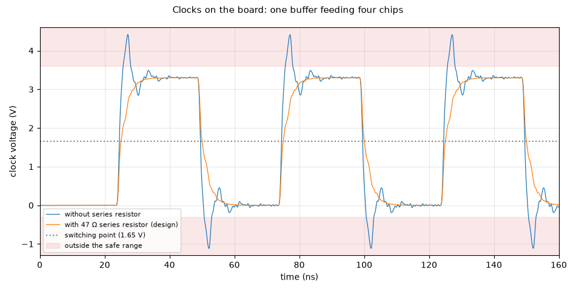

# Clocks on the board: one buffer feeding four chips

**Question:** Does each clock arrive at all four chips clean, with one crossing per edge and no dangerous overshoot?

**Answer (PASS):** Yes. With the 33 Ω resistor the clock reaches the farthest of the four chips with clean edges (3.31 V / -0.01 V, one crossing per edge). Without it, the trace would ring to 4.4 V / -1.1 V, outside the chips' ratings.

## Why it matters

A ringing clock can be counted twice (corrupting the TX pattern or the ADC data), and overshoot stresses the chip inputs.

## What is simulated

A 74LVC2G34 clock buffer drives a 60 Ω board trace with four chip inputs, 3 cm apart, at 20 MHz, with and without the 33 Ω series resistor.

## How to read the plot

The clock voltage at the farthest chip. The dotted line is where the chips decide between 0 and 1; the red bands are outside their ratings.

## The numbers

3 checks pass, 0 fail; 2 rows are for information.

| What | Value | Unit | Limit | OK? | What it means |
|---|---|---|---|---|---|
| Overshoot at the farthest chip, with 33 Ω | 3.31 | V | ≤ 3.6 | yes | parts rated 3.3 V + 0.5 V |
| Undershoot at the farthest chip, with 33 Ω | -0.0139 | V | ≥ -0.3 | yes | parts rated −0.5 V |
| Edges counted per clock (2 per period, 8 expected) | 8 |  | 8 … 8 | yes | more would mean false clocking |
| Overshoot without the resistor (comparison) | 4.41 | V | — | — |  |
| Undershoot without the resistor (comparison) | -1.11 | V | — | — |  |

## Assumptions

- Op-amp: TI's OPA167x model (`sim/models/OPA167x.lib`): gain, bandwidth, noise, output swing, overload.
- Diodes (BAV99): 1N4148 junction model, the same die.
- Transducer (CUSP-TR80-15-2500-TH): standard electrical equivalent (Butterworth–Van Dyke) with C0 = 2.0 nF and Rm = 3 kΩ from the datasheet; its sharpness Q (20–40) is an assumption.
- Gate driver, clock buffers and the FPGA outputs: simple behavioural models (values in each netlist header).
- The channel circuit is exported from `kicad/channel.kicad_sch` at the start of every run.

Run 2026-10-23 22:25 with LTspice by `sim/run.py clock_si`. Testbench: `sim/clock_si.cir`.
