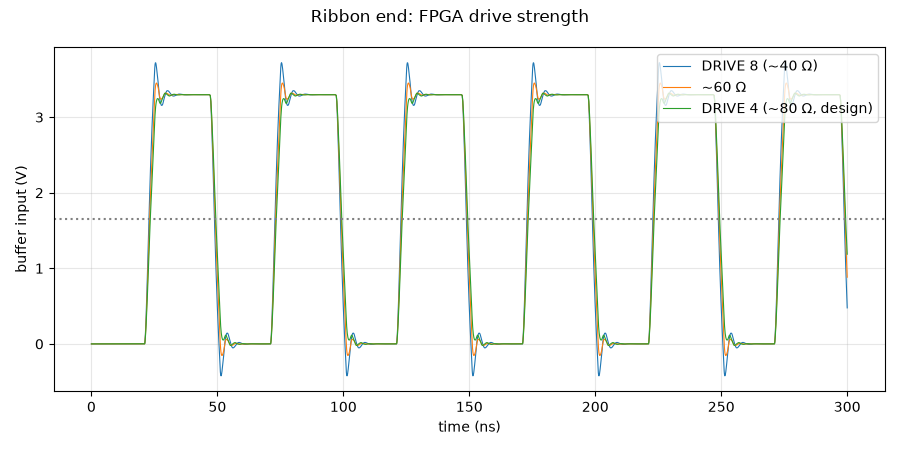

# Clocks from the FPGA: which FPGA drive strength?

**Question:** The clocks come from the FPGA over a 15 cm ribbon cable. Which FPGA output strength gives clean edges at our end?

**Answer (PASS):** DRIVE 4. At that setting the FPGA's output roughly matches the ribbon, so clocks arrive clean (3.32 V / -0.02 V). At DRIVE 8 they would overshoot to 3.7 V and dip to -0.42 V, close to the buffer's −0.5 V limit.

## Why it matters

The ribbon reflects the edges back and forth. The FPGA's drive strength (set in its constraints file) decides how much ringing arrives.

## What is simulated

FPGA output → 6 cm of FPGA-board trace → 15 cm ribbon → our clock buffer input, at 20 MHz, for three FPGA output strengths.

## How to read the plot

The clock voltage at our buffer's input for each drive strength. Same lines and bands as the board clock test.

## The numbers

3 checks pass, 0 fail; 6 rows are for information.

| What | Value | Unit | Limit | OK? | What it means |
|---|---|---|---|---|---|
| FPGA DRIVE 8 (~40 Ω): overshoot at our clock buffer | 3.72 | V | — | — |  |
| FPGA DRIVE 8 (~40 Ω): undershoot at our clock buffer | -0.422 | V | — | — |  |
| FPGA DRIVE 8 (~40 Ω): edges counted (8 expected) | 8 |  | — | — |  |
| ~60 Ω: overshoot at our clock buffer | 3.45 | V | — | — |  |
| ~60 Ω: undershoot at our clock buffer | -0.154 | V | — | — |  |
| ~60 Ω: edges counted (8 expected) | 8 |  | — | — |  |
| FPGA DRIVE 4 (~80 Ω, design): overshoot at our clock buffer | 3.32 | V | ≤ 3.6 | yes |  |
| FPGA DRIVE 4 (~80 Ω, design): undershoot at our clock buffer | -0.021 | V | ≥ -0.3 | yes | buffer rated −0.5 V |
| FPGA DRIVE 4 (~80 Ω, design): edges counted (8 expected) | 8 |  | 8 … 8 | yes |  |

## Assumptions

- Op-amp: TI's OPA167x model (`sim/models/OPA167x.lib`): gain, bandwidth, noise, output swing, overload.
- Diodes (BAV99): 1N4148 junction model, the same die.
- Transducer (CUSP-TR80-15-2500-TH): standard electrical equivalent (Butterworth–Van Dyke) with C0 = 2.0 nF and Rm = 3 kΩ from the datasheet; its sharpness Q (20–40) is an assumption.
- Gate driver, clock buffers and the FPGA outputs: simple behavioural models (values in each netlist header).
- The channel circuit is exported from `kicad/channel.kicad_sch` at the start of every run.

Run 2026-10-25 01:51 with LTspice by `sim/run.py clock_si_drive`. Testbench: `sim/clock_si_drive.cir`.
