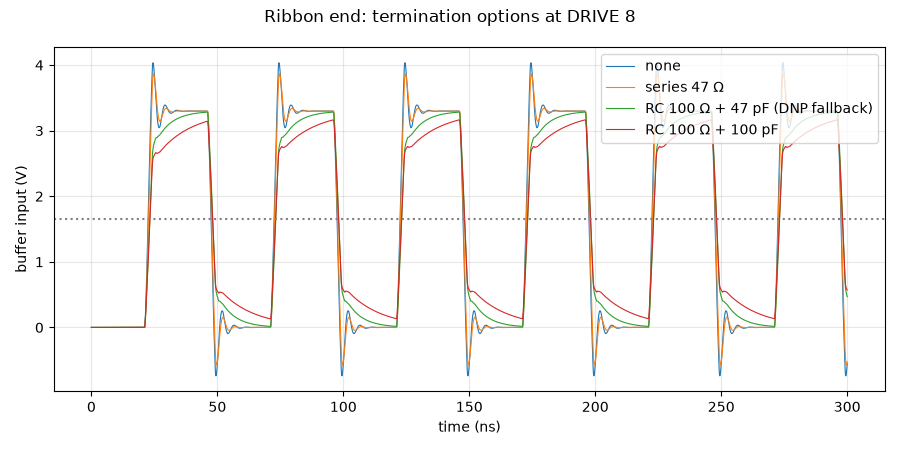

# Ribbon end: termination options at DRIVE 8

Run 2026-10-20 10:40 with LTspice (`sim/run.py clock_si_in`). Netlist: [`sim/clock_si_in.cir`](../clock_si_in.cir).

Same path with the FPGA at DRIVE 8, comparing no termination, a series resistor and RC end terminations at the buffer input.

Models: OPA1678 = TI OPA167x macro-model (`sim/models/OPA167x.lib`); BAV99 = 1N4148 die model, Cj 1.5 pF; CUSA-TR65 = Butterworth–Van Dyke, C0 2.2 nF and Rm 3 kΩ from the datasheet, Q assumed; drivers, buffers and the FPGA are behavioural (values in each netlist header).

## Result: **PASS** (2 pass, 0 fail, 6 info)

| Quantity | Value | Unit | Limit | Status | Note |
|---|---|---|---|---|---|
| none: overshoot | 4.04 | V | — | info |  |
| none: undershoot | -0.738 | V | — | info |  |
| series 47 Ω: overshoot | 3.87 | V | — | info |  |
| series 47 Ω: undershoot | -0.569 | V | — | info |  |
| RC 100 Ω + 47 pF (DNP fallback): overshoot | 3.28 | V | ≤ 3.6 | pass |  |
| RC 100 Ω + 47 pF (DNP fallback): undershoot | 0.0158 | V | ≥ -0.3 | pass |  |
| RC 100 Ω + 100 pF: overshoot | 3.16 | V | — | info |  |
| RC 100 Ω + 100 pF: undershoot | 0.133 | V | — | info |  |

