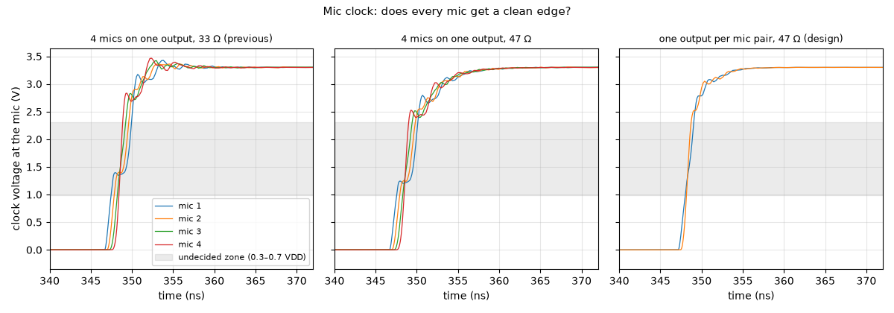

# Mic clock: does every mic get a clean edge?

**Question:** The mic clock runs 200-300 mm down the sides of the array. Does every mic see an edge within its 3 ns limit, with no false clocks?

**Answer (PASS):** Only with one clock output per mic pair. With one output feeding all four mics of a side, the mics nearest the buffer see a staircase edge (2.5 ns between the logic thresholds at 33 Ω, 2.6 ns at 47 Ω; the mic allows about 1.5 ns, i.e. 3 ns edges): the reflection from the far end arrives late. With one output per pair, 47 Ω, every mic sees a clean edge (1.0 ns at worst) with no overshoot.

## Why it matters

The mics need fast clock edges (≤ 3 ns). A series resistor at the buffer only gives clean edges when the loads sit together at the far end of the trace; mics spread along the trace can see a staircase.

## What is simulated

A 74LVC2G34 output drives a 61 Ω (0.25 mm) board trace at 3.07 MHz: either all four mics of one side, 40 mm apart, 200 mm from the buffer, or one mic pair at the end of a 280 mm trace.

## How to read the plot

Each mic's clock voltage during one rising edge. The grey band is where the mic can't tell 0 from 1; the edge must cross it in about 1.5 ns.

## The numbers

8 checks pass, 0 fail; 8 rows are for information.

| What | Value | Unit | Limit | OK? | What it means |
|---|---|---|---|---|---|
| 4 mics on one output, 33 Ω (previous): mic 1, edge time from 0.3 to 0.7 VDD | 2.51 | ns | — | — |  |
| 4 mics on one output, 33 Ω (previous): mic 2, edge time from 0.3 to 0.7 VDD | 1.86 | ns | — | — |  |
| 4 mics on one output, 33 Ω (previous): mic 3, edge time from 0.3 to 0.7 VDD | 1.02 | ns | — | — |  |
| 4 mics on one output, 33 Ω (previous): mic 4, edge time from 0.3 to 0.7 VDD | 0.455 | ns | — | — |  |
| 4 mics on one output, 47 Ω: mic 1, edge time from 0.3 to 0.7 VDD | 2.58 | ns | — | — |  |
| 4 mics on one output, 47 Ω: mic 2, edge time from 0.3 to 0.7 VDD | 1.92 | ns | — | — |  |
| 4 mics on one output, 47 Ω: mic 3, edge time from 0.3 to 0.7 VDD | 1.16 | ns | — | — |  |
| 4 mics on one output, 47 Ω: mic 4, edge time from 0.3 to 0.7 VDD | 0.56 | ns | — | — |  |
| one output per mic pair, 47 Ω (design): mic 1, edge time from 0.3 to 0.7 VDD | 1 | ns | ≤ 1.5 | yes | datasheet: edges ≤ 3 ns (10–90 %), i.e. ≤ 1.5 ns between the thresholds |
| one output per mic pair, 47 Ω (design): mic 1, overshoot | 3.3 | V | ≤ 3.6 | yes | mic input rated 3.6 V |
| one output per mic pair, 47 Ω (design): mic 1, undershoot | -0.00111 | V | ≥ -0.3 | yes | mic input rated −0.3 V |
| one output per mic pair, 47 Ω (design): mic 1, threshold crossings (4 expected) | 4 |  | 4 … 4 | yes | more would mean a false clock |
| one output per mic pair, 47 Ω (design): mic 2, edge time from 0.3 to 0.7 VDD | 0.539 | ns | ≤ 1.5 | yes | datasheet: edges ≤ 3 ns (10–90 %), i.e. ≤ 1.5 ns between the thresholds |
| one output per mic pair, 47 Ω (design): mic 2, overshoot | 3.3 | V | ≤ 3.6 | yes | mic input rated 3.6 V |
| one output per mic pair, 47 Ω (design): mic 2, undershoot | -0.00115 | V | ≥ -0.3 | yes | mic input rated −0.3 V |
| one output per mic pair, 47 Ω (design): mic 2, threshold crossings (4 expected) | 4 |  | 4 … 4 | yes | more would mean a false clock |

## Assumptions

- Op-amp: TI's OPA167x model (`sim/models/OPA167x.lib`): gain, bandwidth, noise, output swing, overload.
- Diodes (BAV99): 1N4148 junction model, the same die.
- Transducer (CUSP-TR80-15-2500-TH): standard electrical equivalent (Butterworth–Van Dyke) with C0 = 2.0 nF and Rm = 3 kΩ from the datasheet; its sharpness Q (20–40) is an assumption.
- Gate driver, clock buffers and the FPGA outputs: simple behavioural models (values in each netlist header).
- The channel circuit is exported from `kicad/channel.kicad_sch` at the start of every run.

Run 2026-10-25 01:52 with LTspice by `sim/run.py mic_clock_si`. Testbench: `sim/mic_clock_si.cir`.
