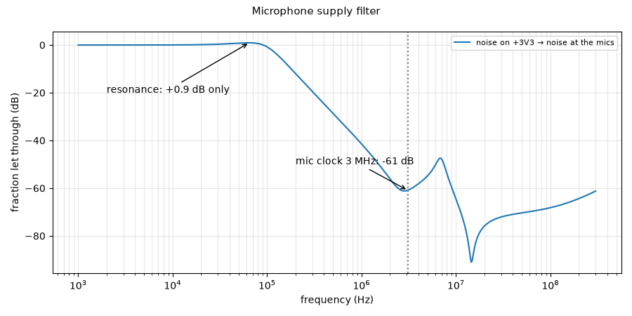

# Microphone supply filter

**Question:** Do the ferrite bead and capacitors keep digital noise on the 3.3 V rail out of the microphones' supply, without creating a resonance?

**Answer (PASS):** Yes. Digital noise at the microphones' clock frequency (3 MHz) is cut by **61 dB** (to 1/1109), and the filter's resonance near 65 kHz peaks by only 0.9 dB, so it does not amplify noise in the ultrasonic band.

## Why it matters

The MEMS microphones are sensitive to supply noise, and a ferrite with a large capacitor can resonate and amplify noise near its resonance.

## What is simulated

+3V3 → 220 Ω ferrite → 10 µF + 8 × 100 nF at the microphones, with a typical ferrite model.

## How to read the plot

How much of the noise on +3V3 reaches the microphones, versus frequency. 0 dB = all of it, −60 dB = a thousandth.

## The numbers

3 checks pass, 0 fail; 2 rows are for information.

| What | Value | Unit | Limit | OK? | What it means |
|---|---|---|---|---|---|
| Noise at the mic clock frequency (3.07 MHz) let through | -60.9 | dB | ≤ -40 | yes | cut to 1/1109 |
| Noise at 100 MHz let through | -68.2 | dB | ≤ -40 | yes |  |
| Resonance peak of the ferrite + 10 µF | 0.947 | dB | ≤ 3 | yes | a big peak would amplify noise in the mics' ultrasonic band |
| Resonance frequency | 64.6 | kHz | — | — |  |
| Low-frequency noise let through at 40 kHz | 0.566 | dB | — | — | not filtered here; the microphone's own supply rejection handles it |

## Assumptions

- Op-amp: TI's OPA167x model (`sim/models/OPA167x.lib`): gain, bandwidth, noise, output swing, overload.
- Diodes (BAV99): 1N4148 junction model, the same die.
- Transducer (CUSA-TR65): standard electrical equivalent (Butterworth–Van Dyke) with C0 = 2.2 nF and Rm = 3 kΩ from the datasheet; its sharpness Q (20–40) is an assumption.
- Gate driver, clock buffers and the FPGA outputs: simple behavioural models (values in each netlist header).
- The channel circuit is exported from `kicad/channel.kicad_sch` at the start of every run.

Run 2026-10-21 12:05 with LTspice by `sim/run.py mic_supply`. Testbench: `sim/mic_supply.cir`.
