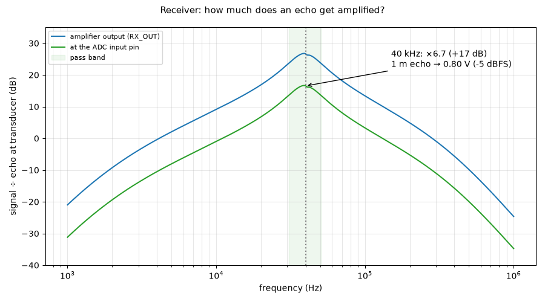

# RX chain: gain, band and ADC filter

Run 2026-10-20 13:56 with LTspice (`sim/run.py rx_chain`). Netlist: [`sim/rx_chain.cir`](../rx_chain.cir).

AC response from the transducer's open-circuit voltage through the limiter, the OPA1678 ×6 stage and the 40 kHz band-pass to the ADC pin, and through the AD7606C-16 (220 kHz) and AD7606B (22.5 kHz) input filters.

Models: OPA1678 = TI OPA167x macro-model (`sim/models/OPA167x.lib`); BAV99 = 1N4148 die model, Cj 1.5 pF; CUSA-TR65 = Butterworth–Van Dyke, C0 2.2 nF and Rm 3 kΩ from the datasheet, Q assumed; drivers, buffers and the FPGA are behavioural (values in each netlist header).

## Result: **PASS** (7 pass, 0 fail, 1 info)

| Quantity | Value | Unit | Limit | Status | Note |
|---|---|---|---|---|---|
| Element loading by the front end at 40 kHz | -0.529 | dB | ≥ -1 | pass | the front end must not load the 2.2 nF element |
| Gain, open-circuit element voltage → ADC pin, 40 kHz | 27 | dB | 25 … 30 | pass | design value +27.6 dB amplifier; 1 m echo 120 mV → ~2.7 V at the ADC |
| Amplifier pass band, low −3 dB | 3.09e+04 | Hz | 25000 … 35000 | pass |  |
| Amplifier pass band, high −3 dB | 5.06e+04 | Hz | 45000 … 60000 | pass |  |
| Amplifier phase change 39 → 41 kHz | 11.8 | ° | ≤ 20 | pass | per-element calibration removes it; small keeps element-to-element spread small |
| AD7606C-16 filter (220 kHz) loss at 39 kHz | -0.00428 | dB | ≥ -0.1 | pass |  |
| AD7606C-16 filter (220 kHz) loss at 41 kHz | -0.00523 | dB | ≥ -0.1 | pass |  |
| AD7606B filter (22.5 kHz) loss at 40 kHz, for comparison | -10.4 | dB | — | info | why the AD7606B was replaced |

