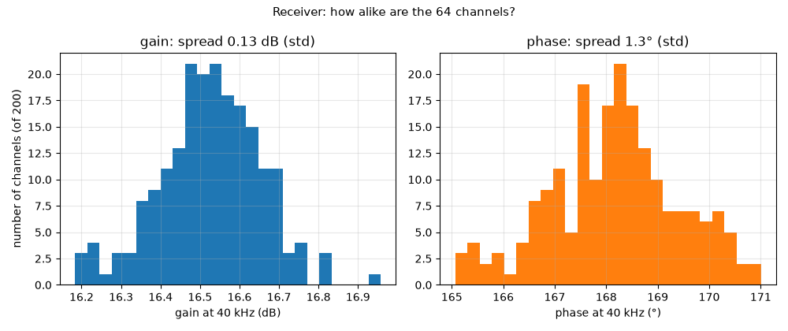

# Receiver: how alike are the 64 channels?

**Question:** Real resistors and capacitors are never exactly their value. How different will the 64 receive channels be in gain and phase?

**Answer (PASS):** With real part tolerances the 64 channels differ by **0.13 dB in gain** and **1.3° in phase** (standard deviation; 5.9° from best to worst of 200). 1.3° is like the echo arriving 0.03 mm early or late, small next to the 8.6 mm wavelength, and fixed for each channel, so a one-time calibration in the FPGA removes it.

## Why it matters

Beamforming adds the 64 channels together with precise delays. If channels differ in phase, the beam points slightly wrong and gets wider. Fixed differences are removed by a one-time calibration, but they should be small to start with.

## What is simulated

200 simulated channels. In each one, every resistor and capacitor gets a random value inside the tolerance written on its schematic value (1 %, or 5 % for C0G and 10 % for X7R capacitors), plus the ADC input divider (1 %), its coupling capacitor (10 %) and the ADC's 10 kΩ input (assumed ±20 %).

## How to read the plot

Two histograms: how many of the 200 channels have a given gain (left) and phase (right) at 40 kHz. Narrow is good.

## The numbers

5 checks pass, 0 fail; 0 rows are for information.

| What | Value | Unit | Limit | OK? | What it means |
|---|---|---|---|---|---|
| Average gain at 40 kHz, element to ADC input pin | 16.5 | dB | 15 … 18.5 | yes | 27 dB amplifier, then the 2k/1k divider (−10 dB) |
| Gain spread between channels (standard deviation) | 0.129 | dB | ≤ 0.5 | yes |  |
| Gain spread, best to worst channel | 0.774 | dB | ≤ 2 | yes |  |
| Phase spread between channels (standard deviation) | 1.25 | ° | ≤ 3 | yes | = the wave arriving 0.03 mm early or late; calibration removes it |
| Phase spread, best to worst channel | 5.94 | ° | ≤ 12 | yes |  |

## Assumptions

- Op-amp: TI's OPA167x model (`sim/models/OPA167x.lib`): gain, bandwidth, noise, output swing, overload.
- Diodes (BAV99): 1N4148 junction model, the same die.
- Transducer (CUSP-TR80-15-2500-TH): standard electrical equivalent (Butterworth–Van Dyke) with C0 = 2.0 nF and Rm = 3 kΩ from the datasheet; its sharpness Q (20–40) is an assumption.
- Gate driver, clock buffers and the FPGA outputs: simple behavioural models (values in each netlist header).
- The channel circuit is exported from `kicad/channel.kicad_sch` at the start of every run.

Run 2026-10-23 22:24 with LTspice by `sim/run.py rx_mc`. Testbench: `sim/rx_mc.cir (generated)`.
