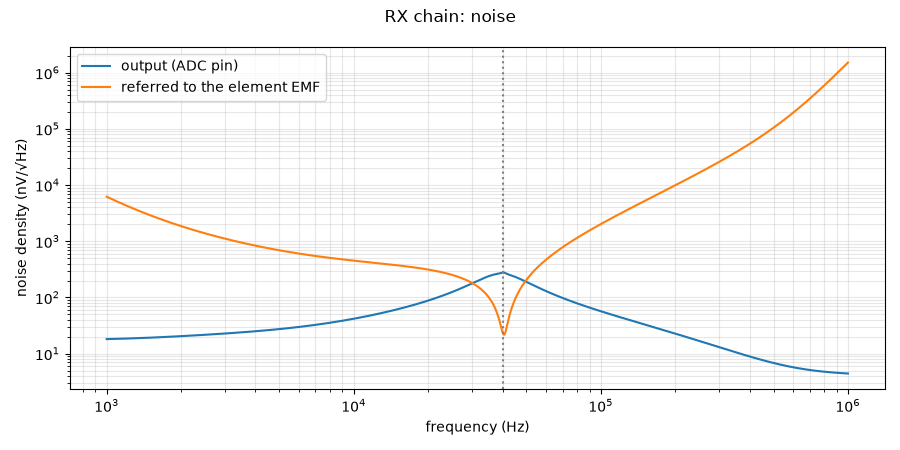

# RX chain: noise

Run 2026-10-20 10:40 with LTspice (`sim/run.py rx_noise`). Netlist: [`sim/rx_noise.cir`](../rx_noise.cir).

Noise at the ADC pin and referred to the element, including the element's own Rm, the limiter resistor and the OPA1678 noise model.

Models: OPA1678 = TI OPA167x macro-model (`sim/models/OPA167x.lib`); BAV99 = 1N4148 die model, Cj 1.5 pF; CUSA-TR65 = Butterworth–Van Dyke, C0 2.2 nF and Rm 3 kΩ from the datasheet, Q assumed; drivers, buffers and the FPGA are behavioural (values in each netlist header).

## Result: **PASS** (5 pass, 0 fail, 0 info)

| Quantity | Value | Unit | Limit | Status | Note |
|---|---|---|---|---|---|
| Output noise density at 40 kHz (ADC pin) | 275 | nV/√Hz | ≤ 500 | pass |  |
| Input-referred noise at 40 kHz (element EMF) | 25.8 | nV/√Hz | ≤ 50 | pass | dominated by the element's Rm and the 4.7 k limiter, not the op-amp |
| Output noise, 30–50 kHz | 33.3 | µV rms | ≤ 60 | pass | AD7606C-16 noise in the same band is estimated at ~50 µV rms (±5 V range) |
| Output noise, 1 kHz–1 MHz | 45.4 | µV rms | ≤ 100 | pass |  |
| SNR of a 1 m echo (2.7 V peak) in 30–50 kHz | 95.2 | dB | ≥ 60 | pass |  |

