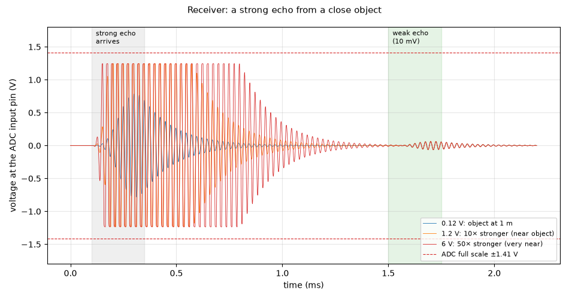

# Receiver: a strong echo from a close object

**Question:** Does a very strong echo (from a close object) damage or confuse the receiver, and how soon can it hear the next, weak echo?

**Answer (PASS):** No. Even an echo 50× stronger than a 1 m echo stays inside the ADC's ±1.41 V full scale (**1.25 V** at most: the clamp diodes and the amplifier's ±5 V rails limit the swing to ±4.2 V, and the 2k/1k divider scales it by 0.31), and the amplifier comes out of saturation at most **0.45 ms** after the echo ends. What remains is the transducer itself ringing on (it is a resonator, like a struck bell): after the strongest echo that ringing is still faintly there when the next echo arrives 1.15 ms later, but the weak echo still comes through at 0.065 V every time, as expected for a 10 mV echo. A strong echo leaves no lasting effect on the electronics.

## Why it matters

Close objects return echoes many times stronger than distant ones. The receiver must survive them, and recover fast enough to hear what comes after.

## What is simulated

Three runs with a strong echo of 0.12 V (an object at 1 m), 1.2 V and 6 V at the transducer, then a weak 10 mV echo 1.4 ms later. Echo voltages are measured at the transducer terminals, the same way as in the gain test, so 0.12 V here is the same 1 m echo that gives 0.86 V at the ADC there.

## How to read the plot

Voltage at the ADC input pin over time, one colour per strength. The grey band is when the strong echo arrives; the trace goes on after it because the transducer keeps ringing (it is a resonator). The strong echoes are flattened where the amplifier saturates (±4.2 V, ±1.3 V after the divider), inside the dashed ±1.41 V ADC full scale. Each trace then decays back to zero, and the weak echo (green band) comes out the same size in all three runs.

## The numbers

9 checks pass, 0 fail; 3 rows are for information.

| What | Value | Unit | Limit | OK? | What it means |
|---|---|---|---|---|---|
| 0.12 V: object at 1 m: highest voltage at the ADC input | 0.784 | V | ≤ 1.41 | yes | inside the ADC's ±1.41 V full scale: the amplifier's ±4.2 V swing × 0.31 divider |
| 0.12 V: object at 1 m: amplifier back out of saturation, after the echo ends | 0 | ms | ≤ 1 | yes | the electronics recover; 0 = never saturated |
| 0.12 V: object at 1 m: transducer's own ringing below 50 mV, after the echo ends | 0.579 | ms | — | — | the transducer is a resonator; faded |
| 0.12 V: object at 1 m: the later weak echo at the ADC input | 0.0654 | V | 0.056 … 0.0839 | yes | expected about 0.070 V (10 mV × 22 × 0.31): no lasting effect |
| 1.2 V: 10× stronger (near object): highest voltage at the ADC input | 1.25 | V | ≤ 1.41 | yes | inside the ADC's ±1.41 V full scale: the amplifier's ±4.2 V swing × 0.31 divider |
| 1.2 V: 10× stronger (near object): amplifier back out of saturation, after the echo ends | 0.223 | ms | ≤ 1 | yes | the electronics recover; 0 = never saturated |
| 1.2 V: 10× stronger (near object): transducer's own ringing below 50 mV, after the echo ends | 0.889 | ms | — | — | the transducer is a resonator; faded |
| 1.2 V: 10× stronger (near object): the later weak echo at the ADC input | 0.0652 | V | 0.056 … 0.0839 | yes | expected about 0.070 V (10 mV × 22 × 0.31): no lasting effect |
| 6 V: 50× stronger (very near): highest voltage at the ADC input | 1.24 | V | ≤ 1.41 | yes | inside the ADC's ±1.41 V full scale: the amplifier's ±4.2 V swing × 0.31 divider |
| 6 V: 50× stronger (very near): amplifier back out of saturation, after the echo ends | 0.448 | ms | ≤ 1 | yes | the electronics recover; 0 = never saturated |
| 6 V: 50× stronger (very near): transducer's own ringing below 50 mV, after the echo ends | 1.13 | ms | — | — | the transducer is a resonator; still faintly ringing when the next echo arrives |
| 6 V: 50× stronger (very near): the later weak echo at the ADC input | 0.0618 | V | 0.056 … 0.0839 | yes | expected about 0.070 V (10 mV × 22 × 0.31): no lasting effect |

## Assumptions

- Op-amp: TI's OPA167x model (`sim/models/OPA167x.lib`): gain, bandwidth, noise, output swing, overload.
- Diodes (BAV99): 1N4148 junction model, the same die.
- Transducer (CUSP-TR80-15-2500-TH): standard electrical equivalent (Butterworth–Van Dyke) with C0 = 2.0 nF and Rm = 3 kΩ from the datasheet; its sharpness Q (20–40) is an assumption.
- Gate driver, clock buffers and the FPGA outputs: simple behavioural models (values in each netlist header).
- The channel circuit is exported from `kicad/channel.kicad_sch` at the start of every run.

Run 2026-10-23 22:24 with LTspice by `sim/run.py rx_overload`. Testbench: `sim/rx_overload.cir`.
