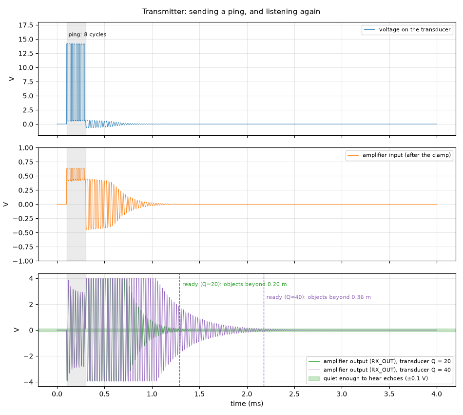

# Transmitter: sending a ping, and listening again

**Question:** When an element sends a ping, is the drive safe for every part, and how soon after can the same element hear an echo?

**Answer (PASS):** Yes. The transducer gets **14.2 V** pulses, the driver peaks at 0.28 A (rated 5 A) and the clamp keeps the amplifier input within **+0.63 / -0.45 V**. After the ping the transducer keeps ringing for a while, and its own receiver hears that: it can hear echoes again **1.0–1.9 ms** after the ping, so it misses objects closer than about **0.20–0.36 m**. (The two numbers bracket the transducer's unknown Q.) In split mode other elements listen, which avoids this blind zone.

## Why it matters

The 15 V drive must never reach the sensitive amplifier input. And the element can only hear echoes once its own ringing has died down, which sets the closest object it can see.

## What is simulated

The gate driver (modelled as a 15 V switch) sends 8 cycles at 40 kHz through the channel from the schematic, then holds low while the element listens. The transducer's sharpness (Q) is not in its datasheet, so the test runs with Q = 20 and Q = 40, which bracket its 1.8 ms ring-down time.

## How to read the plot

Top: the 0–14 V ping on the transducer (grey band). Middle: the amplifier input, held within ±0.6 V by the clamp diodes during the ping. Bottom: the amplifier output. The receiver is overloaded during the ping and then hears the transducer ringing down; once the trace stays inside the green band, echoes can be heard. The dashed lines mark that moment and the matching closest distance.

## The numbers

9 checks pass, 0 fail; 0 rows are for information.

| What | Value | Unit | Limit | OK? | What it means |
|---|---|---|---|---|---|
| Voltage on the transducer during the ping | 14.2 | V | 13 … 15.5 | yes | 15 V supply minus one diode drop |
| Peak current from the gate driver | 0.283 | A | ≤ 1 | yes | UCC27524 is rated 5 A |
| Amplifier input during the ping, positive peak | 0.634 | V | ≤ 0.9 | yes | the clamp diodes keep the 15 V away from the op-amp |
| Amplifier input during the ping, negative peak | -0.451 | V | ≥ -0.9 | yes |  |
| Heat in the 47 Ω drive resistor (during the ping) | 14.3 | mW | ≤ 50 | yes | rated 100 mW |
| Heat in the 4.7 kΩ protection resistor (during the ping) | 19.2 | mW | ≤ 50 | yes | rated 100 mW |
| Highest voltage at the ADC input during the ping | 1.24 | V | ≤ 1.41 | yes | ADC full scale ±1.41 V |
| Time until the element can listen again (Q = 20) | 0.99 | ms | ≤ 2.5 | yes | echoes from closer than 0.20 m arrive while it is still ringing |
| Time until the element can listen again (Q = 40) | 1.88 | ms | ≤ 2.5 | yes | echoes from closer than 0.36 m arrive while it is still ringing |

## Assumptions

- Op-amp: TI's OPA167x model (`sim/models/OPA167x.lib`): gain, bandwidth, noise, output swing, overload.
- Diodes (BAV99): 1N4148 junction model, the same die.
- Transducer (CUSP-TR80-15-2500-TH): standard electrical equivalent (Butterworth–Van Dyke) with C0 = 2.0 nF and Rm = 3 kΩ from the datasheet; its sharpness Q (20–40) is an assumption.
- Gate driver, clock buffers and the FPGA outputs: simple behavioural models (values in each netlist header).
- The channel circuit is exported from `kicad/channel.kicad_sch` at the start of every run.

Run 2026-10-25 01:31 with LTspice by `sim/run.py tx_burst`. Testbench: `sim/tx_burst.cir`.
