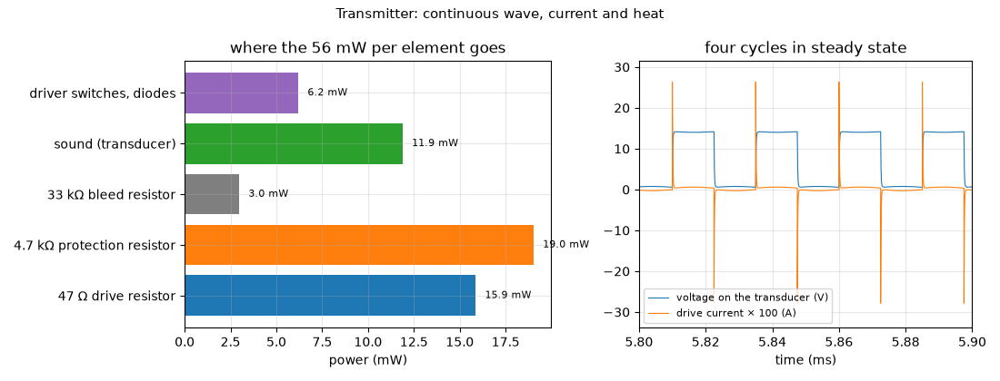

# Transmitter: continuous wave, current and heat

**Question:** In continuous-wave mode (Doppler, split mode) an element transmits all the time. How much current does it draw from the 15 V supply, and does any part get too hot?

**Answer (PASS):** Each transmitting element draws **3.7 mA** (56 mW) from the 15 V supply; all 64 together draw **239 mA**, about a quarter of what the supply can give. No part runs hot: the biggest single loss is the receiver's own 4.7 kΩ protection resistor at 19 mW (rated 100 mW). Only about 12 mW becomes sound.

## Why it matters

This is the heaviest load on the 15 V supply and the hottest case for the drive and protection resistors.

## What is simulated

One element driven at 40 kHz without stopping, from the schematic's channel, until it reaches a steady state.

## How to read the plot

Left: where the power drawn by one element goes. Right: four cycles of the transducer voltage and drive current.

## The numbers

7 checks pass, 0 fail; 1 rows are for information.

| What | Value | Unit | Limit | OK? | What it means |
|---|---|---|---|---|---|
| Supply current per transmitting element | 3.73 | mA | ≤ 5 | yes | C·V²·f alone would be 1.3 mA; see the power split below |
| Supply current with all 64 elements transmitting | 239 | mA | ≤ 900 | yes | the 15 V boost converter can deliver about 0.9 A |
| Heat in the 47 Ω drive resistor | 15.9 | mW | ≤ 50 | yes | rated 100 mW |
| Heat in the 4.7 kΩ protection resistor | 19 | mW | ≤ 50 | yes | rated 100 mW |
| Heat in the 33 kΩ bleed resistor | 2.98 | mW | ≤ 50 | yes |  |
| Power turned into sound (model) | 11.9 | mW | — | — |  |
| Current through the clamp diodes (average) | 1.45 | mA | ≤ 50 | yes | BAV99 rated 200 mA |
| Voltage swing on the transducer | 13.6 | V | 13 … 16 | yes |  |

## Assumptions

- Op-amp: TI's OPA167x model (`sim/models/OPA167x.lib`): gain, bandwidth, noise, output swing, overload.
- Diodes (BAV99): 1N4148 junction model, the same die.
- Transducer (CUSA-TR65): standard electrical equivalent (Butterworth–Van Dyke) with C0 = 2.2 nF and Rm = 3 kΩ from the datasheet; its sharpness Q (20–40) is an assumption.
- Gate driver, clock buffers and the FPGA outputs: simple behavioural models (values in each netlist header).
- The channel circuit is exported from `kicad/channel.kicad_sch` at the start of every run.

Run 2026-10-21 12:05 with LTspice by `sim/run.py tx_cw`. Testbench: `sim/tx_cw.cir`.
